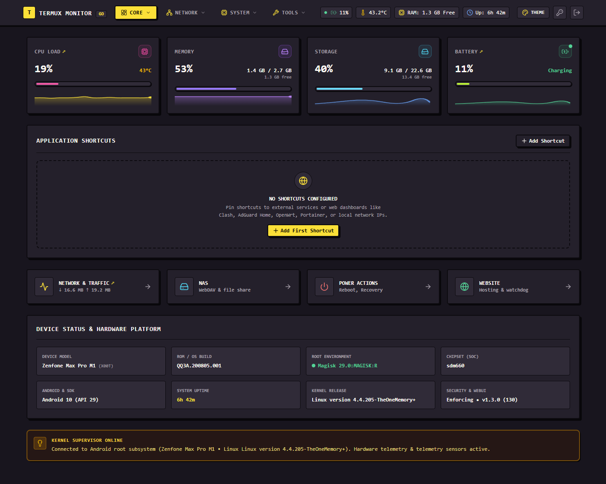
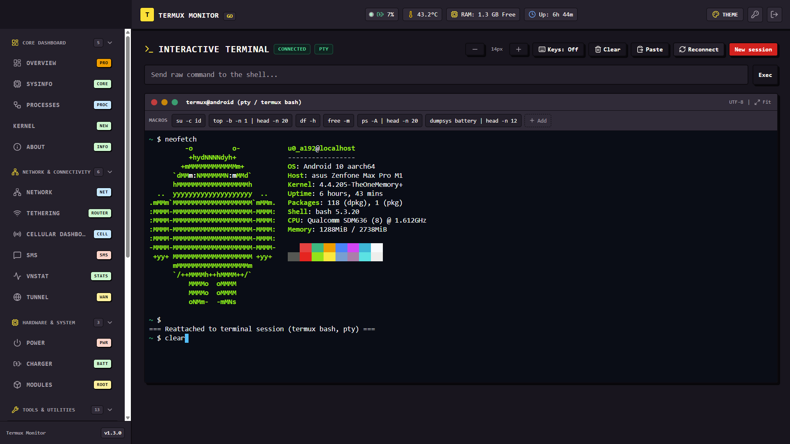

# Termux Monitor

An ultra-lightweight, fully offline Android control panel that runs as a Magisk / KernelSU / APatch module. The backend is modular Go, the frontend is a Svelte 5 single-page application, and everything ships inside one self-contained binary with no runtime dependency on Python, Node.js or Bun on the device.

- Version: v1.3.0
- Module id: `termux_monitor`
- Default address: `http://<phone-ip>:80` and `https://<phone-ip>:443`
- License: GPL-3.0
---



---

## Table of Contents

1. [Highlights](#highlights)
2. [Tabs and Features](#tabs-and-features)
3. [Installation](#installation)
4. [First Login](#first-login)
5. [Configuration](#configuration)
6. [Build Requirements](#build-requirements)
7. [Building from Source](#building-from-source)
8. [Build Flavors](#build-flavors)
9. [Verification Checklist](#verification-checklist)
10. [Project Layout](#project-layout)
11. [HTTP API](#http-api)
12. [Security Notes](#security-notes)
13. [Troubleshooting](#troubleshooting)
14. [Credits and License](#credits-and-license)

---

## Highlights

| Aspect | Detail |
| :--- | :--- |
| Distribution | Single Android ARM64 binary (`webui`) packaged as a Magisk module zip |
| Backend | Go 1.26, modular packages under `internal/`, no CGO (`CGO_ENABLED=0`) |
| Frontend | Svelte 5 + TypeScript + Tailwind CSS 3, compiled by Vite 8 and embedded with `embed.FS` |
| Offline | No CDN, no external font, no telemetry, no analytics |
| Transport | HTTP on port 80 plus self-signed TLS on port 443 (auto-generated on first start) |
| Auth | Cookie based session (`tmon_session`) with a configurable password |
| WebSocket | Interactive terminal PTY and scrcpy screen mirroring |

The whole product is one process. Every tab talks to the local daemon over the same HTTP server, and privileged operations are executed through `su -c` so that the WebUI itself can run as root from the module directory.

---

## Tabs and Features

### Overview and Metrics
- `overview` - dashboard with CPU load, memory, storage, battery, network throughput and quick toggles.
- `sysinfo` - detailed `/proc` counters, per-core frequencies and governor information.
- `processes` - running process list read from `/proc`, with runtime detection, owner, executable path and a guarded stop action.
- `kernel` - CPU cluster tuning, governor profiles, VM parameters and persisted kernel configuration.
- `network` - sysctl driven TCP tuning, DNS selection and TTL configuration, all resolved from `network_config.json`.
- `vnstat` - bandwidth accounting wrapper with daily, monthly and reset actions.
- `speedtest` - start, poll, stop and review history of throughput tests.

### Android Control
- `charger` - hardware specific charging current and voltage limit controllers.
- `hotspot` - SoftAP control, connected client list via ARP/lease parsing, MAC filter and router settings reconciliation.
- `power` - reboot, shutdown and scheduled power actions.
- `modem` - non-proprietary telemetry only: signal quality, SIM status, SIM slot switch, thermal readings and cell scan.
- `sms` - inbox viewer parsed from modem storage and the ROM SMS database.
- `modules` - list, toggle and install Magisk/KernelSU modules.

### System Services
- `ssh` - Dropbear SSH daemon configuration and lifecycle.
- `telegram` - bot based remote control and remote proxy endpoint served by the same WebUI.
- `tunnel` - expose the local panel through a tunnel binary, including binary upload from the UI.
- `nas` - SMB/FTP style local file sharing for the phone storage.
- `website` - host small sites on the phone with `static`, `node` or `php` engines, each with its own port and log view.
- `cron` - cron job manager with a cronie host backend and a pure Go fallback scheduler, per job logs and dry-run.
- `store` - Termux package manager front end with health-check catalog and mirror management.
- `database` - browse SQLite files, list tables, inspect schema and run queries against the built-in WASM SQLite engine.
- `backup` - export and import the full Termux Monitor configuration, plus an optional cloud sync channel.

### Workspace
- `files` - file manager with navigation, upload, download, copy, move, batch rename, compress, extract, permission editing and search.
- `logs` - application log viewer plus a live `logcat` stream.
- `terminal` - interactive PTY over WebSocket.
- `scrcpy` - screen mirroring and input forwarding rendered with WebCodecs (requires the HTTPS endpoint).
- `tools` - configuration backup export and maintenance helpers.
- `about` - version, module status and update information.

---

## Installation

### From a release zip

1. Download `Termux-Monitor-Magisk-v1.3.0.zip`.
2. Open Magisk / KernelSU / APatch and choose "Install from storage".
3. Select the zip and reboot after the installer finishes.
4. The module starts the daemon immediately. If it does not, `service.sh` starts it after boot.

### From Termux (manual)

```sh
pkg install golang
git clone https://github.com/sainz1407/termux-monitor.git
cd termux-monitor
go build -ldflags "-s -w" -o webui .
sudo ./webui --port 8080
```

The `--port` flag and the `PORT` environment variable both control the HTTP listener. `--https-port` (or `HTTPS_PORT`) controls TLS; pass `0` to disable it.

### Runtime flags

| Flag | Default | Purpose |
| :--- | :--- | :--- |
| `--port` | `80` | HTTP listen port |
| `--https-port` | `443` | HTTPS listen port, `0` disables TLS |
| `--apply-tweaks` | `false` | Apply saved network and kernel tuning, then exit |

`service.sh` calls `webui --apply-tweaks` on every boot so persisted tuning survives reboots.

---

## First Login

1. Open `http://<phone-ip>:80` on the same network.
2. Log in with the default password `tmon`.
3. Change the password immediately from the About or Account section.

Sessions use the `tmon_session` cookie. All `/api/*` endpoints are session gated; only the static bundle and the login endpoint are public. The password can be preset with `TMON_PASSWORD` or changed from the UI, which writes `auth.json` inside the module directory.

---

## Configuration

Environment variables read at startup:

| Variable | Default | Purpose |
| :--- | :--- | :--- |
| `TMON_PASSWORD` | `tmon` | Initial admin password |
| `PORT` | `80` | HTTP port override |
| `HTTPS_PORT` | `443` | HTTPS port override |
| `TMON_SU_BIN` | `su` | Root helper binary (`su`, `ksu`, `apatch`, absolute path) |
| `TMON_MODULE_DIR` | `/data/adb/modules/termux_monitor` | Module root used for state files |
| `TMON_ALLOWED_DIRS` | `/sdcard,/storage,/data/adb,/data/local/tmp,/data/system` | Allowed roots for the file manager |
| `TMON_SMS_DB` | auto-detected | Override path to the ROM `mmssms.db` |
| `TMON_LEASES_FILE` | `/data/misc/dhcp/dnsmasq.leases` | Lease file for hotspot client parsing |

Persisted configuration lives next to the binary as JSON files, for example `network_config.json`, `kernel_config.json`, `charger_config.json`, `ssh_config.json`, `telegram_config.json`, `nas.json`, `tunnel.json` and `power_schedule.json`. The Magisk installer preserves every known config file across updates.

---

## Build Requirements

| Tool | Version used |
| :--- | :--- |
| Go | 1.26 or newer |
| Node.js | 22 or newer |
| npm | 10 or newer (`bun` is optional) |
| Python | 3.9 or newer, only for `scripts/audit_nomodem.py` |

Frontend dependency versions are pinned in `frontend/package.json`: Svelte 5.56, Vite 8, TypeScript 6 and Tailwind CSS 3.

---

## Building from Source

### 1. Build the frontend

```sh
cd frontend
npm install
npm run build
cd ..
```

The output is written into the embedded asset directory, so the Go build must always run afterwards.

### 2. Build the Android binary

Windows (PowerShell):

```powershell
$env:GOOS="android"; $env:GOARCH="arm64"; $env:CGO_ENABLED="0"
go build -tags nomodem -ldflags "-s -w" -o webui .
```

Linux / Termux / macOS:

```sh
GOOS=android GOARCH=arm64 CGO_ENABLED=0 go build -ldflags "-s -w" -o webui .
```

### 3. Package the Magisk zip

Windows:

```powershell
.\build-release.bat
```

Linux / Termux:

```sh
./build.sh              # binary only
make release            # both flavor zips
```

`build-release.bat` and `make release` produce:

- `Termux-Monitor-Magisk-v1.3.0.zip`
- `Termux-Monitor-Magisk-v1.3.0-nomodem.zip`

Each zip contains `META-INF/`, `customize.sh`, `module.prop`, `service.sh`, `system.prop`, `update.json`, `env.example`, `uninstall.sh`, `bin/` and the `webui` binary.

---

## Build Flavors

Both flavors compile from identical sources.

| Flavor | Command | Notes |
| :--- | :--- | :--- |
| Full | `go build ./...` | Standard release |
| No-modem | `go build -tags nomodem ./...` | The `nomodem` tag is a no-op alias kept so CI and packaging stay identical |

Proprietary baseband tooling (QRTR/DIAG/EFS2, vendor RIL helpers) is no longer part of the codebase. `internal/modem` only exposes telemetry that any Android device provides. `scripts/audit_nomodem.py` scans a built binary for residual vendor strings and must report PASS for both flavors.

---

## Verification Checklist

Run these before opening a pull request or publishing a release:

```sh
GOOS=android GOARCH=arm64 go build ./...
GOOS=android GOARCH=arm64 go build -tags nomodem ./...

go vet ./...
go vet -tags nomodem ./...

go test ./...
go test -tags nomodem ./...

cd frontend && npx svelte-check --tsconfig ./tsconfig.app.json
cd frontend && npm run build

python scripts/audit_nomodem.py webui
python scripts/audit_nomodem.py webui-nomodem
```

Cross-compiled test binaries cannot be executed on desktop hosts; run `go test` natively for the unit test suite.

---

## Project Layout

```text
main.go                     Entry point, flags, HTTP/HTTPS servers, background managers
internal/auth/              Session manager and cookie handling
internal/backup/            Configuration export, import and cloud sync
internal/charger/           Charging current/voltage limit controllers
internal/cron/              cronie host backend and Go fallback scheduler
internal/database/          SQLite service built on ncruces/go-sqlite3 (WASM)
internal/filemanager/       File navigation, archive and transfer helpers
internal/handlers/          HTTP handlers and route registration per feature
internal/hotspot/           SoftAP control, client parsing, router reconciliation
internal/kernel/            Governor, cluster and VM tuning
internal/logger/            Structured logging
internal/modem/             Read-only modem telemetry
internal/modules/           Magisk/KernelSU module detection and install
internal/nas/               Local network sharing service
internal/network/           sysctl/DNS/TTL tuning driven by network_config.json
internal/power/             Power actions and scheduler
internal/procmon/           Running process list, runtime detection and guarded stop
internal/scrcpy/            Screen mirroring hub, AVCC packetization, input channel
internal/smsviewer/         SMS retrieval and parsing
internal/speedtest/         Throughput test runner
internal/ssh/               Dropbear control
internal/store/             Termux package store, catalog, mirror management
internal/sysinfo/           /proc counters
internal/telegram/          Telegram bot control plane
internal/terminal/          PTY WebSocket terminal
internal/tlsgen/            Self-signed certificate generation
internal/tunnel/            Tunnel engine management
internal/version/           Version metadata
internal/vnstat/            Bandwidth accounting wrapper
internal/website/           Static/node/php site hosting
internal/worker/            Periodic background scheduler
frontend/                   Svelte 5 SPA, embedded through frontend/embed.go
scripts/audit_nomodem.py    Zero-leak regression guard
```

---

## HTTP API

Every route below requires an authenticated session cookie unless noted otherwise.

| Group | Endpoints |
| :--- | :--- |
| Auth | `POST /api/auth/login`, `POST /api/auth/logout`, `GET /api/auth/status`, `POST /api/auth/change-password` |
| System | `GET /api/sysinfo`, `GET /api/stats`, `POST /api/power`, `GET /api/logs`, `POST /api/logs/clear` |
| Processes | `GET /api/processes`, `POST /api/processes/kill` |
| Files | `/api/files/` list, read, save, upload, download, mkdir, create, delete, copy, move, batch, compress, extract, permissions, search, storage |
| Network | `/api/network/` dns, dns/reset, ttl, ping; `/api/hotspot/` status, control, clients, settings |
| Modem | `/api/modem/signal`, `/api/modem/thermal`, `/api/modem/cell_scan`, `/api/modem/sim/status`, `/api/modem/sim/switch`, `GET /api/sms/inbox` |
| Kernel | `/api/kernel/` status, cluster, profile, vm; `/api/sysinfo/governor` |
| Store | `/api/store/` status, list, install, install/log, op, op/log, mirror |
| Cron | `/api/cron/` crontab, daemon, jobs, jobs/add, jobs/delete, jobs/run, jobs/toggle, dry-run, runs, service, download |
| Website | `/api/website/` list, probe, add, start, stop, restart, delete, logs |
| Database | `/api/database/` status, ls, tables, schema, query |
| Services | `/api/ssh/*`, `/api/telegram/*`, `/api/tunnel/*`, `/api/nas/*`, `/api/speedtest/*`, `/api/vnstat/*`, `/api/backup/*` |
| WebSocket | `/api/terminal/ws`, `/api/scrcpy/ws`, `/api/logs/logcat/stream` |

Long running operations (package install, cron operations) return a handle and stream progress through their matching log endpoint.

---

## Security Notes

- The panel is meant for a trusted LAN or a private tunnel. Do not expose port 80 or 443 directly to the internet without a tunnel or VPN.
- Change the default password `tmon` immediately after the first login.
- TLS uses a self-signed certificate generated at first start; browsers will warn until you accept or pin the certificate. `scrcpy` mirroring requires the HTTPS endpoint because WebCodecs needs a secure context.
- Privileged commands run through `su -c`; the WebUI process itself runs as root from the module directory.
- File manager access is limited to `TMON_ALLOWED_DIRS`.
- `uninstall.sh` stops the daemon but intentionally leaves your JSON configuration behind, and does not revert sysctl changes. Reboot to restore stock kernel and network behavior.

---

## Troubleshooting

| Symptom | Action |
| :--- | :--- |
| Panel not reachable after install | Check `/data/adb/modules/termux_monitor/webui.log`, confirm the module is enabled and `service.sh` ran after boot |
| Port 80 busy | Run `webui --port 8080` or set `PORT` |
| Login rejected | Reset by editing `auth.json` in the module directory, or restart with `TMON_PASSWORD=tmon` |
| `scrcpy` shows a black screen | Open the panel through `https://<phone-ip>:443`, accept the certificate and reload. Use a current Chromium based browser |
| Store operations fail | Package installs need working DNS on the device; `store` reports the exact failure in its log view |
| Cron jobs do not fire | The UI reports whether the cronie daemon or the Go fallback scheduler is active; make sure the module survives battery optimization |
| Tunings reset after reboot | Confirm `service.sh` runs `webui --apply-tweaks` and that the module is not in a disabled state |

---

## Credits and License

Built and maintained by `sainz1407`. Repository: <https://github.com/sainz1407/termux-monitor>.

Third-party components: `gorilla/websocket`, `creack/pty`, `ncruces/go-sqlite3` (WASM SQLite), `golang.org/x/crypto`, `golang.org/x/net`, Svelte, Vite and Tailwind CSS.

Released under the GNU General Public License v3.0. See `LICENSE`.
